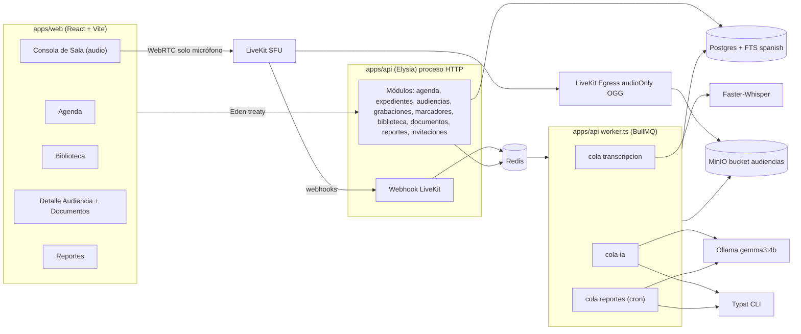
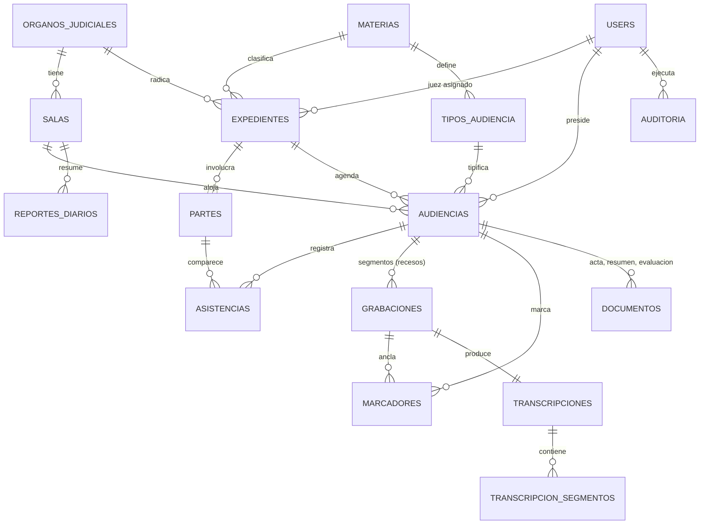
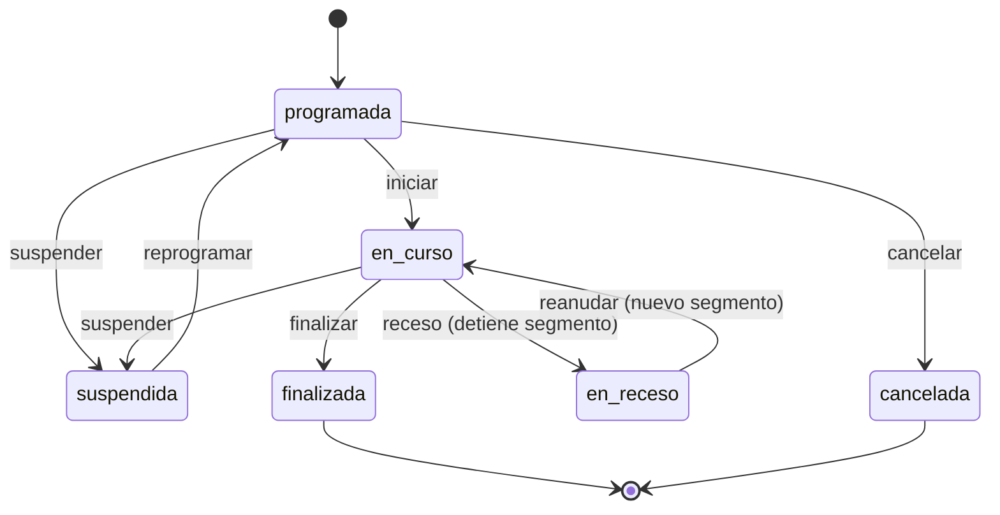
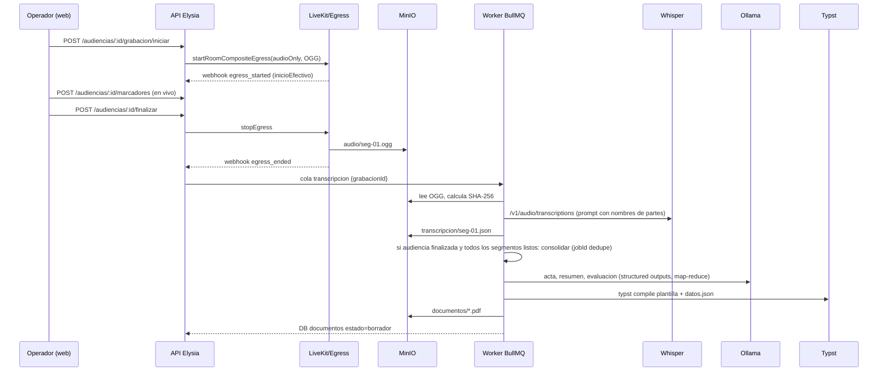

# Plan: Pivote Zoom-Out → Sistema de Audiencias Judiciales (Audio + IA)

Transformar el PoC de videollamadas en un sistema autoalojado para **salas de audiencias judiciales de Nicaragua (TZ `America/Managua`)** con: agenda de audiencias, grabación **solo audio** vía LiveKit Egress con marcadores en vivo, transcripción Whisper, biblioteca jerárquica (CMS judicial), Acta Integral + Resumen Simple, evaluación predictiva con LLM local (Ollama) y reporte diario por sala. Todos los documentos se generan en **PDF server-side con Typst** (plantilla `base.typ` + una plantilla por informe).

---

## Hallazgos de la auditoría

| # | Hallazgo | Ubicación | Acción en el plan |
|---|----------|-----------|-------------------|
| H1 | `GEMINI.md` es un symlink roto → `/home/cristian/Software/zoom-out/AGENTS.md` | raíz | Re-apuntar a `AGENTS.md` (relativo) |
| H2 | ADR-001 dice "sin signup público" pero existe `POST /auth/signup` abierto (rol `viewer`) y página `/signup` | [auth/index.ts](file:///home/cristian/Proyectos/zoom-out/apps/api/src/modules/auth/index.ts#L43-L81) | Eliminar signup (inaceptable en ámbito judicial) |
| H3 | ADR-003 documenta alias `@/`; el código real usa `@api/`, `@web/`, `@db/` | [adr.md](file:///home/cristian/Proyectos/zoom-out/.codebase-memory/adr.md#L25-L31) | Corregir ADR |
| H4 | `RecordingControls` llama `useCallback` **después** de un `return null` condicional → viola Rules of Hooks | [RecordingControls.tsx](file:///home/cristian/Proyectos/zoom-out/apps/web/src/components/video/RecordingControls.tsx) | Componente se reemplaza; patrón corregido |
| H5 | `processRecordingTranscription` captura y traga errores → los `attempts: 3` de BullMQ nunca se usan | [transcription.service.ts](file:///home/cristian/Proyectos/zoom-out/apps/api/src/services/transcription.service.ts#L138-L141) | Re-lanzar; marcar `fallida` solo en el último intento |
| H6 | Webhooks importan la cola desde el archivo del worker; worker corre dentro del proceso API | [webhooks/index.ts](file:///home/cristian/Proyectos/zoom-out/apps/api/src/modules/webhooks/index.ts#L6), [index.ts](file:///home/cristian/Proyectos/zoom-out/apps/api/src/index.ts#L44-L45) | `lib/colas.ts` + proceso `worker.ts` separado (LLM/Whisper son jobs de minutos) |
| H7 | Egress compuesto H264 720p (video) + extracción ffmpeg | [livekit.ts](file:///home/cristian/Proyectos/zoom-out/apps/api/src/lib/livekit.ts#L103-L125) | Egress `audioOnly` OGG/Opus; se elimina ffmpeg |
| H8 | Eden legacy `edenTreaty` + casts `as unknown as` en páginas | [client.ts](file:///home/cristian/Proyectos/zoom-out/apps/web/src/api/client.ts) | Migrar a `treaty` (Eden v2) |
| H9 | Dashboard con métricas falsas hardcodeadas (`[TRAFFIC_NODE_01]: 42ms`) | `pages/Dashboard.tsx` | Reemplazar por Agenda |
| H10 | `minio-init` usa entrypoint inline; `infra/minio/init-buckets.sh` duplicado y sin usar | [docker-compose.yml](file:///home/cristian/Proyectos/zoom-out/infra/docker-compose.yml#L113-L130) | Montar y usar el script |
| H11 | Whisper: compose default `tiny`, `.env.example` `large-v3-turbo`; imagen `fedirz/faster-whisper-server` renombrada upstream (speaches) | compose | Unificar default; documentar riesgo |
| H12 | `refresh_tokens` definido pero sin uso | [schema.ts](file:///home/cristian/Proyectos/zoom-out/apps/api/drizzle/schema.ts#L84-L93) | Eliminar en baseline nuevo |
| H13 | Cero tests (`--pass-with-no-tests`) | — | Tests unitarios de lógica pura |
| H14 | Host: 14 hilos, 30 GB RAM, **sin GPU**; contenedores `viva-next-v2-postgres/valkey` activos (posible choque 5432/6379) | entorno | Ver riesgos |

Estado base: `bun run typecheck` ✅ (api + web). `livekit-server-sdk@2.15.2` soporta `audioOnly`, `audioMixing`, `canPublishSources`, `EncodedFileType.OGG` ✅. `typst 0.15.1` instalado en `~/.local/bin` ✅.

---

## Decisiones confirmadas

| Tema | Decisión |
|------|----------|
| Datos | Reset limpio: nuevo baseline Drizzle `0000` + `docker compose down -v` |
| Topología | Híbrida: PC de sala (operador) publica micrófono(s) + partes remotas opcionales vía invitación solo-audio |
| Roles | `admin`, `juez`, `secretario`, `operador`, `consulta` |
| Jurisdicción | Nicaragua, `TZ_JUZGADO=America/Managua`, terminología CPP (Ley 406): Ministerio Público, Defensa, Acusado, Víctima, Acusador Particular, PGR |
| Documentos | Typst: `base.typ` + `acta-integral.typ`, `resumen-simple.typ`, `evaluacion-predictiva.typ`, `reporte-diario.typ`; PDF generado en servidor |
| Evaluación IA | Solo `juez` + `admin`, flag `IA_EVALUACION_HABILITADA`, descargo fijo inyectado server-side |

---

## User Review Required

> [!CAUTION]
> **Reset destructivo**: `docker compose down -v` borra volúmenes `pg_data`, `minio_data` (grabaciones PoC en MinIO). Las migraciones `0000_sad_hellion` se eliminan y se regenera un baseline judicial. `infra/outputs/` (local, ignorado) no se toca.

> [!WARNING]
> **Cambios incompatibles de API**: se eliminan `/rooms`, `/recordings`, `/auth/signup`. El JWT cambia `role` → `rol` con nuevos valores → todas las sesiones actuales se invalidan (logout forzado por 401 ya implementado).

> [!IMPORTANT]
> **Lenguaje ubicuo en español**: tablas, rutas y tipos de dominio en español (`audiencias`, `expedientes`, `Grabacion`, `/agenda`); infraestructura técnica en inglés donde ya existe (`lib/db.ts`, `env`). Comentarios en español (regla del repo).

> [!IMPORTANT]
> **Rendimiento CPU-only** (sin GPU detectada): `gemma3:4b` Q4 ≈ 3.3 GB RAM, orden de ~8–15 tok/s en 14 hilos → un acta tarda minutos. Whisper `large-v3-turbo` en CPU es aprox. 0.3–1× tiempo real → una audiencia de 2 h puede tardar 1–2 h en transcribirse. Todo corre en cola asíncrona; la UI muestra estado. Se medirá en Fase 5 y se ajustará modelo (`small`/`medium`) si hace falta.

> [!WARNING]
> **Ética / legal de la evaluación predictiva**: el LLM nunca escribe hechos deterministas (nombres, fechas, partes, hash) — los inyecta el servidor. Toda salida IA nace en estado `borrador` con marca de agua "BORRADOR — GENERADO POR IA" y requiere aprobación humana (secretario/juez). La evaluación lleva descargo fijo y nunca es visible para `secretario`, `operador`, `consulta`.

> [!NOTE]
> **Dependencias nuevas**: `@tanstack/react-query` (web: cache + polling de estados del pipeline), `@sinclair/typebox` explícito en `validators` (ya transitivo vía Elysia; se necesita `Value.Check` para validar salida del LLM). Binario `typst` requerido en host (dev) / imagen (prod) vía env `TYPST_BIN`. Se elimina `fluent-ffmpeg`.

---

## Open Questions

> [!IMPORTANT]
> 1. **Formato oficial del número de expediente**: ¿texto libre o validar con regex? Propuesta: texto libre, ejemplo seed `000123-ORM4-2026-PN`; `anio` y `materia` se guardan aparte (no se parsean del número).
> 2. **Object Lock en MinIO**: el bucket `audiencias` se crea `--with-lock` (solo posible al crearlo). ¿Retención por defecto? Propuesta: sin retención por defecto (solo versionado) ahora; configurable luego con `mc retention set`.
> 3. **Membrete Typst**: ¿hay escudo/logo oficial del Poder Judicial a usar? Propuesta: placeholder SVG en `apps/api/typst/assets/escudo.svg` reemplazable.
> 4. **Hora del reporte diario automático**: propuesta `REPORTE_DIARIO_CRON="0 18 * * 1-5"` en `America/Managua` + generación manual on-demand.
> 5. **Diarización por hablante**: v1 usa audio mezclado (sin diarización; el LLM infiere hablantes con ayuda de marcadores). v2 opcional: Track Egress por participante → atribución exacta. ¿OK diferirlo?

---

## Arquitectura objetivo



### Modelo de dominio



### Ciclo de vida de una audiencia



Documento: `pendiente → generando → borrador → aprobado` (o `fallido`; regenerar vuelve a `generando`, incrementa `version`).

### Pipeline post-audiencia



### Jerarquía determinista en MinIO

Un **único árbol físico canónico** (vista por Caso). Las vistas cronológica/órgano-fecha son **proyecciones de la DB**, sin duplicar objetos.

```text
audiencias/                                   ← bucket (versionado + object lock)
└── {organo}/{materia}/{anioExpediente}/{expediente}/{yyyy-mm}/{dd}/{HHmm}_{id8}/
    ├── audio/seg-01.ogg, seg-02.ogg          ← un segmento por tramo (recesos)
    ├── transcripcion/seg-01.json, completa.json
    ├── documentos/acta-integral-v1.pdf, resumen-simple-v1.pdf, evaluacion-predictiva-v1.pdf
    ├── marcadores.json
    └── manifiesto.json                        ← SHA-256 de cada objeto (cadena de custodia)
└── {organo}/_reportes-diarios/{sala}/{yyyy-mm}/{dd}.pdf
```

Ejemplo: `jdpa1-mga/penal/2026/000123-orm4-2026-pn/2026-10/29/0930_a1b2c3d4/audio/seg-01.ogg`.
Fechas en `TZ_JUZGADO`; el mes incluye año para no colisionar si la audiencia ocurre en un año distinto al del expediente. El prefijo se calcula desde `programadaInicio` y se **congela** en `audiencias.prefijo_almacenamiento` al iniciar la primera grabación.

---

## Proposed Changes

Orden por capas de dependencia. Cada bloque = 1+ commits en español.

---

### 1. Infraestructura (`infra/`, `.env.example`, `scripts/`)

#### [MODIFY] [docker-compose.yml](file:///home/cristian/Proyectos/zoom-out/infra/docker-compose.yml)
- Agregar `ollama` + `ollama-init` (pull del modelo), volumen `ollama_models`.
- `minio-init` monta y ejecuta `init-buckets.sh`.
- Whisper default `${WHISPER_MODEL:-large-v3-turbo}`.

```yaml
  # ──── Ollama (LLM local para actas y evaluación) ────
  ollama:
    image: ollama/ollama:latest
    container_name: zoomout-ollama
    restart: unless-stopped
    ports:
      - "11434:11434"
    volumes:
      - ollama_models:/root/.ollama
    environment:
      OLLAMA_KEEP_ALIVE: 30m
      OLLAMA_NUM_PARALLEL: 1
      OLLAMA_CONTEXT_LENGTH: ${OLLAMA_NUM_CTX:-16384}
    healthcheck:
      test: ["CMD", "ollama", "list"]
      interval: 10s
      timeout: 5s
      retries: 10

  ollama-init:
    image: ollama/ollama:latest
    container_name: zoomout-ollama-init
    restart: "no"
    depends_on:
      ollama:
        condition: service_healthy
    environment:
      OLLAMA_HOST: ollama:11434
    entrypoint: ["/bin/sh", "-c", "ollama pull ${OLLAMA_MODEL:-gemma3:4b}"]

  minio-init:
    image: minio/mc:latest
    depends_on: { minio: { condition: service_healthy } }
    restart: "no"
    environment:
      MINIO_ACCESS_KEY: ${MINIO_ACCESS_KEY}
      MINIO_SECRET_KEY: ${MINIO_SECRET_KEY}
      MINIO_BUCKET_AUDIENCIAS: ${MINIO_BUCKET_AUDIENCIAS:-audiencias}
    volumes:
      - ./minio/init-buckets.sh:/init-buckets.sh:ro
    entrypoint: ["/bin/sh", "/init-buckets.sh"]
```

#### [MODIFY] [init-buckets.sh](file:///home/cristian/Proyectos/zoom-out/infra/minio/init-buckets.sh)
Defensivo (`set -eu`, reintentos de alias), crea bucket con lock (implica versionado):
```sh
mc mb --ignore-existing --with-lock "local/${MINIO_BUCKET_AUDIENCIAS}"
mc version enable "local/${MINIO_BUCKET_AUDIENCIAS}"
```
Se eliminan buckets `recordings` y `transcriptions`.

#### [MODIFY] [egress.yaml.template](file:///home/cristian/Proyectos/zoom-out/infra/livekit/egress.yaml.template), [setup-lan.sh](file:///home/cristian/Proyectos/zoom-out/scripts/setup-lan.sh)
`MINIO_BUCKET_RECORDINGS` → `MINIO_BUCKET_AUDIENCIAS` (lista de vars de `envsubst` L108/L146).

#### [MODIFY] [.env.example](file:///home/cristian/Proyectos/zoom-out/.env.example)
```dotenv
# ──── Juzgado ────
TZ_JUZGADO=America/Managua
# ──── MinIO ────
MINIO_BUCKET_AUDIENCIAS=audiencias          # reemplaza MINIO_BUCKET_RECORDINGS
# ──── Whisper ────
WHISPER_IDIOMA=es
# ──── Ollama ────
OLLAMA_URL=http://localhost:11434
OLLAMA_MODEL=gemma3:4b
OLLAMA_NUM_CTX=16384
# ──── IA / Documentos ────
IA_EVALUACION_HABILITADA=true
TYPST_BIN=typst
REPORTE_DIARIO_CRON=0 18 * * 1-5
```

#### [MODIFY] [package.json](file:///home/cristian/Proyectos/zoom-out/package.json) (raíz)
- `dev:worker`: `bun --env-file .env --filter @zoom-out/api dev:worker`; `dev:apps` levanta api + worker + web.
- `setup`: verificar `typst` (`command -v "${TYPST_BIN:-typst}"`) con aviso.

---

### 2. Contratos compartidos (`packages/shared-types`, `packages/validators`)

Fuente única de verdad de enums: tuplas `as const` en `shared-types` → usadas por Drizzle (`pgEnum`), TypeBox (`t.UnionEnum`) y TS.

#### [NEW] `packages/shared-types/src/judicial.ts`
```ts
// Enums del dominio judicial — fuente única para DB, validadores y UI
export const ROLES_USUARIO = ['admin', 'juez', 'secretario', 'operador', 'consulta'] as const
export type RolUsuario = (typeof ROLES_USUARIO)[number]

export const ESTADOS_AUDIENCIA = ['programada', 'en_curso', 'en_receso', 'suspendida', 'finalizada', 'cancelada'] as const
export type EstadoAudiencia = (typeof ESTADOS_AUDIENCIA)[number]

export const ROLES_PARTE = ['acusado', 'victima', 'ministerio_publico', 'defensa', 'acusador_particular',
  'procuraduria', 'actor', 'demandado', 'apoderado', 'perito', 'testigo', 'otro'] as const
export const TIPOS_MARCADOR = ['apertura', 'alegato_apertura', 'declaracion', 'prueba', 'objecion',
  'incidente', 'receso', 'alegato_cierre', 'resolucion', 'nota'] as const
export const TIPOS_DOCUMENTO = ['acta_integral', 'resumen_simple', 'evaluacion_predictiva'] as const
export const ESTADOS_DOCUMENTO = ['pendiente', 'generando', 'borrador', 'aprobado', 'fallido'] as const
export const ESTADOS_GRABACION = ['iniciando', 'grabando', 'procesando', 'transcribiendo', 'lista', 'fallida'] as const
export const VISTAS_BIBLIOTECA = ['caso', 'cronologica', 'organo_fecha'] as const

// Máquina de estados tipada — compartida API (validación) ↔ Web (habilitar botones)
export const TRANSICIONES_AUDIENCIA = {
  programada: ['en_curso', 'suspendida', 'cancelada'],
  en_curso: ['en_receso', 'suspendida', 'finalizada'],
  en_receso: ['en_curso', 'suspendida', 'finalizada'],
  suspendida: ['programada'],
  finalizada: [],
  cancelada: [],
} as const satisfies Record<EstadoAudiencia, readonly EstadoAudiencia[]>

export const puedeTransicionar = <D extends EstadoAudiencia>(
  de: D, a: EstadoAudiencia,
): a is (typeof TRANSICIONES_AUDIENCIA)[D][number] =>
  (TRANSICIONES_AUDIENCIA[de] as readonly EstadoAudiencia[]).includes(a)

// Niveles de la biblioteca por vista
export const NIVELES_BIBLIOTECA = {
  caso: ['organo', 'materia', 'anio_expediente', 'expediente', 'mes', 'dia', 'audiencia'],
  cronologica: ['organo', 'expediente', 'materia', 'anio', 'mes', 'dia', 'audiencia'],
  organo_fecha: ['organo', 'anio', 'mes', 'dia', 'audiencia'],
} as const satisfies Record<(typeof VISTAS_BIBLIOTECA)[number], readonly string[]>

export const DESCARGO_EVALUACION =
  'Análisis orientativo generado automáticamente por un modelo de lenguaje local. No constituye ' +
  'criterio jurisdiccional, no sustituye la valoración de la prueba por la autoridad judicial ' +
  'competente y no debe citarse como fundamento de resolución alguna.'
```

#### [MODIFY] `user.ts` — `UserRole` → `RolUsuario`, `AuthTokenPayload.rol`.
#### [NEW] `audiencia.ts`, `expediente.ts`, `biblioteca.ts`, `documento.ts`, `reporte.ts` — interfaces de respuesta (`AudienciaAgenda`, `NodoBiblioteca`, `MetricasReporteDiario`, …).
#### [DELETE] `room.ts`, `recording.ts` (→ `TranscriptSegment` migra a `transcripcion.ts` con `inicioMs/finMs`).

#### [NEW] `packages/validators/src/` — `catalogo.schemas.ts`, `expediente.schemas.ts`, `audiencia.schemas.ts`, `marcador.schemas.ts`, `biblioteca.schemas.ts`, `documento.schemas.ts`, `reporte.schemas.ts`, **`ia.schemas.ts`**.

`ia.schemas.ts` — mismo schema TypeBox sirve como JSON Schema para `format` de Ollama, validación runtime (`Value.Check`) y tipo TS (`Static`):
```ts
import { t } from 'elysia'

export const ActaIntegralIA = t.Object({
  apertura: t.String(),
  desarrollo: t.Array(t.Object({
    titulo: t.String(),
    contenido: t.String(),
    refSegundos: t.Optional(t.Number({ minimum: 0 })),
  })),
  incidencias: t.Array(t.String()),
  resoluciones: t.Array(t.Object({ descripcion: t.String(), fundamento: t.Optional(t.String()) })),
  cierre: t.String(),
})

export const ResumenSimpleIA = t.Object({
  queSucedio: t.String(),
  puntosClave: t.Array(t.String()),
  decisiones: t.Array(t.String()),
  proximosPasos: t.Array(t.String()),
})

export const EvaluacionPredictivaIA = t.Object({
  hechosClave: t.Array(t.Object({
    descripcion: t.String(), aportadoPor: t.String(), refSegundos: t.Optional(t.Number()),
  })),
  balance: t.Array(t.Object({            // genérico: Ministerio Público vs Defensa, o Actor vs Demandado
    parte: t.String(),
    fortalezas: t.Array(t.String()),
    debilidades: t.Array(t.String()),
    solidez: t.Integer({ minimum: 0, maximum: 10 }),
  })),
  inclinacion: t.UnionEnum(['acusacion', 'defensa', 'equilibrado', 'indeterminado']),
  resolucionProbable: t.Object({ tipo: t.String(), descripcion: t.String() }),
  confianza: t.Number({ minimum: 0, maximum: 1 }),
  fundamentacion: t.String(),
  limitaciones: t.Array(t.String()),
})
// El descargo NO está en el schema: lo agrega el servidor (DESCARGO_EVALUACION)
```

#### [DELETE] `room.schemas.ts`, `recording.schemas.ts`; `auth.schemas.ts` pierde `signupBody`/`refreshBody`.
#### [MODIFY] `packages/validators/package.json` — deps `@zoom-out/shared-types: workspace:*`, `@sinclair/typebox` (misma versión que usa Elysia).

---

### 3. Base de datos (`apps/api/drizzle`, `apps/api/scripts`)

#### [DELETE] `drizzle/migrations/0000_sad_hellion.sql` + `meta/*`
#### [MODIFY] [schema.ts](file:///home/cristian/Proyectos/zoom-out/apps/api/drizzle/schema.ts) — reescritura (extracto):
```ts
import { ROLES_USUARIO, ESTADOS_AUDIENCIA, /* … */ } from '@zoom-out/shared-types'

export const rolUsuario = pgEnum('rol_usuario', ROLES_USUARIO)
export const estadoAudiencia = pgEnum('estado_audiencia', ESTADOS_AUDIENCIA)
// … rol_parte, tipo_marcador, tipo_documento, estado_documento, estado_grabacion

const tsvector = customType<{ data: string }>({ dataType: () => 'tsvector' })
const ts = (n: string) => timestamp(n, { withTimezone: true })

export const organosJudiciales = pgTable('organos_judiciales', {
  id: uuid().primaryKey().defaultRandom(),
  codigo: text().notNull().unique(),          // 'JDPA1-MGA' → slug en rutas MinIO
  nombre: text().notNull(),                   // 'Juzgado Primero de Distrito Penal de Audiencias de Managua'
  circunscripcion: text().notNull(),
  activo: boolean().notNull().default(true),
  createdAt: ts('created_at').notNull().defaultNow(),
})

export const salas = pgTable('salas', {
  id: uuid().primaryKey().defaultRandom(),
  organoId: uuid('organo_id').notNull().references(() => organosJudiciales.id),
  codigo: text().notNull(), nombre: text().notNull(),
}, (t) => [unique().on(t.organoId, t.codigo)])

export const materias = pgTable('materias', { id: uuid().primaryKey().defaultRandom(),
  codigo: text().notNull().unique(), nombre: text().notNull() })        // PN, CV, FA, LB…
export const tiposAudiencia = pgTable('tipos_audiencia', { /* materiaId, nombre */ })

export const expedientes = pgTable('expedientes', {
  id: uuid().primaryKey().defaultRandom(),
  organoId: uuid('organo_id').notNull().references(() => organosJudiciales.id),
  materiaId: uuid('materia_id').notNull().references(() => materias.id),
  numero: text().notNull(),                   // '000123-ORM4-2026-PN'
  anio: integer().notNull(),
  caratula: text().notNull(),                 // delito / objeto del proceso
  juezId: uuid('juez_id').references(() => users.id),
  estado: text().notNull().default('activo'),
  createdAt: ts('created_at').notNull().defaultNow(),
}, (t) => [unique().on(t.organoId, t.numero), index().on(t.organoId, t.materiaId, t.anio)])

export const partes = pgTable('partes', {
  id: uuid().primaryKey().defaultRandom(),
  expedienteId: uuid('expediente_id').notNull().references(() => expedientes.id, { onDelete: 'cascade' }),
  rol: rolParte().notNull(), nombre: text().notNull(), identificacion: text(),
  representaAId: uuid('representa_a_id'),     // defensa → acusado
})

export const audiencias = pgTable('audiencias', {
  id: uuid().primaryKey().defaultRandom(),
  expedienteId: uuid('expediente_id').notNull().references(() => expedientes.id),
  salaId: uuid('sala_id').notNull().references(() => salas.id),
  tipoAudienciaId: uuid('tipo_audiencia_id').notNull().references(() => tiposAudiencia.id),
  juezId: uuid('juez_id').notNull().references(() => users.id),
  estado: estadoAudiencia().notNull().default('programada'),
  programadaInicio: ts('programada_inicio').notNull(),
  programadaFin: ts('programada_fin').notNull(),
  inicioReal: ts('inicio_real'), finReal: ts('fin_real'),
  motivoSuspension: text('motivo_suspension'),
  livekitRoomName: text('livekit_room_name').unique(),
  prefijoAlmacenamiento: text('prefijo_almacenamiento'),
  creadoPor: uuid('creado_por').notNull().references(() => users.id),
  createdAt: ts('created_at').notNull().defaultNow(), updatedAt: ts('updated_at').notNull().defaultNow(),
}, (t) => [index().on(t.salaId, t.programadaInicio), index().on(t.juezId, t.programadaInicio)])

export const grabaciones = pgTable('grabaciones', {
  id: uuid().primaryKey().defaultRandom(),
  audienciaId: uuid('audiencia_id').notNull().references(() => audiencias.id),
  secuencia: integer().notNull(),              // 1..n (recesos generan nuevo segmento)
  estado: estadoGrabacion().notNull().default('iniciando'),
  egressId: text('egress_id').unique(),
  audioKey: text('audio_key'), sha256: text(), bytes: bigint({ mode: 'number' }),
  duracionMs: integer('duracion_ms'), offsetGlobalMs: integer('offset_global_ms'),
  inicioSolicitado: ts('inicio_solicitado').notNull().defaultNow(),
  inicioEfectivo: ts('inicio_efectivo'),       // de webhook egress_started
  fin: ts('fin'),
}, (t) => [unique().on(t.audienciaId, t.secuencia)])

export const marcadores = pgTable('marcadores', {
  id: uuid().primaryKey().defaultRandom(),
  audienciaId: uuid('audiencia_id').notNull().references(() => audiencias.id, { onDelete: 'cascade' }),
  grabacionId: uuid('grabacion_id').references(() => grabaciones.id),
  tipo: tipoMarcador().notNull(), etiqueta: text().notNull(), nota: text(),
  marcadoEn: ts('marcado_en').notNull().defaultNow(),   // reloj de pared; offset se deriva
  creadoPor: uuid('creado_por').notNull().references(() => users.id),
})

export const transcripcionSegmentos = pgTable('transcripcion_segmentos', {
  id: bigserial({ mode: 'number' }).primaryKey(),
  transcripcionId: uuid('transcripcion_id').notNull().references(() => transcripciones.id, { onDelete: 'cascade' }),
  audienciaId: uuid('audiencia_id').notNull(),          // desnormalizado para búsqueda
  idx: integer().notNull(), inicioMs: integer('inicio_ms').notNull(), finMs: integer('fin_ms').notNull(),
  texto: text().notNull(),
  busqueda: tsvector().generatedAlwaysAs(sql`to_tsvector('spanish', texto)`),
}, (t) => [index('seg_busqueda_gin').using('gin', t.busqueda), index().on(t.audienciaId, t.idx)])

// + transcripciones (1:1 grabación), asistencias, documentos (unique audiencia+tipo, contenido jsonb,
//   version, pdfKey, sha256Pdf, aprobadoPor/At), reportes_diarios (unique sala+fecha, metricas jsonb,
//   sintesis, pdfKey), auditoria (userId, accion, entidad, entidadId, meta jsonb, ip, createdAt)
```

#### [NEW] `drizzle/migrations/0001_agenda_sin_solapes.sql` (custom, `drizzle-kit generate --custom`)
Garantía a nivel DB de que una sala no tenga dos audiencias superpuestas:
```sql
CREATE EXTENSION IF NOT EXISTS btree_gist;
ALTER TABLE audiencias ADD CONSTRAINT audiencias_sala_sin_solape
  EXCLUDE USING gist (sala_id WITH =, tstzrange(programada_inicio, programada_fin, '[)') WITH &&)
  WHERE (estado NOT IN ('cancelada', 'suspendida'));
```
La API mapea `23P01` → `409 CONFLICT`. Solape del **juez** = validación en app (409 salvo `forzar: true`).

#### [MODIFY] [seed.ts](file:///home/cristian/Proyectos/zoom-out/apps/api/scripts/seed.ts)
Idempotente (`onConflictDoNothing`). Base: usuarios por rol (`admin@pj.local`, `juez.morales@pj.local`, `secretaria.lopez@pj.local`, `operador.ruiz@pj.local`, `consulta@pj.local`), materias (PN, CV, FA, LB, PA), tipos de audiencia por materia (Penal: Preliminar, Inicial, Juicio Oral y Público, Especial de Revisión de Medida, Ejecución; Familia: Inicial, Vista de la Causa; Civil: Inicial, Probatoria; Laboral: Juicio), órganos de Managua con 2 salas c/u. Flag `--demo`: 4 expedientes ficticios con partes + audiencias distribuidas en la semana actual en distintos estados.

#### [NEW] `apps/api/scripts/ingestar-audio.ts`
`bun run audio:ingestar --audiencia <id> --archivo muestra.ogg` → sube a la clave canónica, crea grabación `procesando`, encola transcripción. Permite probar Whisper→IA→Typst **sin LiveKit**.

---

### 4. API — núcleo (`apps/api/src/lib`, `apps/api/src/plugins`)

#### [NEW] `src/plugins/auth.ts` (reemplaza [requireRole.ts](file:///home/cristian/Proyectos/zoom-out/apps/api/src/middleware/requireRole.ts))
Macro Elysia 1.4 con `resolve` → `user` tipado no-nulo, roles por ruta, cero `any`:
```ts
export const auth = new Elysia({ name: 'auth' }).macro({
  roles: (roles: readonly RolUsuario[]) => ({
    async resolve({ headers, status }) {
      const h = headers.authorization
      const payload = h?.startsWith('Bearer ') ? await verifyJwt<AuthTokenPayload>(h.slice(7)) : null
      if (!payload) return status(401, { code: 'UNAUTHORIZED', message: 'Token inválido o ausente' })
      if (!roles.includes(payload.rol))
        return status(403, { code: 'FORBIDDEN', message: `Rol '${payload.rol}' sin permiso` })
      return { user: payload }
    },
  }),
})
// uso: .get('/', ({ user }) => …, { roles: ['admin', 'secretario'] })
```

#### [NEW] `src/lib/storage-keys.ts` — claves deterministas, sin dependencias (usa `Intl` para TZ):
```ts
export const slug = (v: string) =>
  v.normalize('NFD').replace(/\p{Diacritic}/gu, '').toLowerCase()
    .replace(/[^a-z0-9]+/g, '-').replace(/^-+|-+$/g, '').slice(0, 80)

export function partesFecha(d: Date, timeZone = env.TZ_JUZGADO) {
  const p = Object.fromEntries(new Intl.DateTimeFormat('en-CA', {
    timeZone, year: 'numeric', month: '2-digit', day: '2-digit', hour: '2-digit', minute: '2-digit', hourCycle: 'h23',
  }).formatToParts(d).map((x) => [x.type, x.value]))
  return { yyyy: p.year, mm: p.month, dd: p.day, hh: p.hour, mi: p.minute }
}

export function prefijoAudiencia(a: {
  organoCodigo: string; materiaCodigo: string; expedienteAnio: number
  expedienteNumero: string; programadaInicio: Date; audienciaId: string
}) {
  const f = partesFecha(a.programadaInicio)
  return [slug(a.organoCodigo), slug(a.materiaCodigo), String(a.expedienteAnio), slug(a.expedienteNumero),
    `${f.yyyy}-${f.mm}`, f.dd, `${f.hh}${f.mi}_${a.audienciaId.slice(0, 8)}`].join('/')
}
export const claveAudio = (prefijo: string, seq: number) => `${prefijo}/audio/seg-${String(seq).padStart(2, '0')}.ogg`
```

#### [MODIFY] [livekit.ts](file:///home/cristian/Proyectos/zoom-out/apps/api/src/lib/livekit.ts)
```ts
// Egress de audio exclusivamente — sin video, OGG/Opus mezclado
export async function iniciarEgressAudio(roomName: string, filepath: string) {
  const file = new EncodedFileOutput({ fileType: EncodedFileType.OGG, filepath, output: { case: 's3', value: s3Minio() } })
  return egressClient.startRoomCompositeEgress(roomName, { file }, {
    audioOnly: true,
    encodingOptions: new EncodingOptions({ audioCodec: AudioCodec.OPUS, audioBitrate: 96, audioFrequency: 48000 }),
  })
}

// Token: solo micrófono — el servidor impide publicar cámara/pantalla aunque el cliente lo intente
export async function crearTokenAudio(roomName: string, identidad: string, nombre: string, puedeHablar: boolean) {
  const at = new AccessToken(env.LIVEKIT_API_KEY, env.LIVEKIT_API_SECRET, { identity: identidad, name: nombre, ttl: '6h' })
  at.addGrant({ roomJoin: true, room: roomName, canSubscribe: true, canPublishData: true,
    canPublish: puedeHablar, canPublishSources: [TrackSource.MICROPHONE] })
  return at.toJwt()
}
```

#### [NEW] `src/lib/colas.ts` — `Queue` de `transcripcion`, `ia`, `reportes` + `FlowProducer` (conexión Redis única). Desacopla webhooks/módulos del worker (H6).
#### [NEW] `src/lib/ollama.ts`
```ts
export async function generarJson<S extends TSchema>(p: {
  sistema: string; usuario: string; esquema: S; temperatura?: number
}): Promise<Static<S>> {
  const res = await fetch(`${env.OLLAMA_URL}/api/chat`, {
    method: 'POST',
    signal: AbortSignal.timeout(20 * 60_000),
    body: JSON.stringify({
      model: env.OLLAMA_MODEL, stream: false,
      format: p.esquema,                                   // structured outputs (JSON Schema)
      options: { temperature: p.temperatura ?? 0.2, num_ctx: env.OLLAMA_NUM_CTX },
      messages: [{ role: 'system', content: p.sistema }, { role: 'user', content: p.usuario }],
    }),
  })
  if (!res.ok) throw new Error(`Ollama ${res.status}: ${await res.text()}`)
  const { message } = (await res.json()) as { message: { content: string } }
  const datos: unknown = JSON.parse(message.content)
  if (!Value.Check(p.esquema, datos)) throw new ErrorSalidaIA([...Value.Errors(p.esquema, datos)])
  return datos
}
```
#### [NEW] `src/lib/typst.ts`
```ts
// Renderiza una plantilla Typst con datos JSON → PDF (Buffer). Determinista: fuentes embebidas + SOURCE_DATE_EPOCH
export async function renderizarPdf(plantilla: PlantillaTypst, datos: unknown, fecha: Date): Promise<Buffer> {
  const id = crypto.randomUUID()
  const rel = `/.cache/${id}.json`
  await Bun.write(join(DIR_TYPST, rel), JSON.stringify(datos))
  try {
    const proc = Bun.spawn([env.TYPST_BIN, 'compile', '--root', DIR_TYPST, '--input', `datos=${rel}`,
      '--ignore-system-fonts', join(DIR_TYPST, `${plantilla}.typ`), '-'], {
      env: { ...process.env, SOURCE_DATE_EPOCH: String(Math.floor(fecha.getTime() / 1000)) },
      stdout: 'pipe', stderr: 'pipe',
    })
    const [pdf, err, code] = await Promise.all([new Response(proc.stdout).arrayBuffer(),
      new Response(proc.stderr).text(), proc.exited])
    if (code !== 0) throw new Error(`Typst (${plantilla}): ${err}`)
    return Buffer.from(pdf)
  } finally { await rm(join(DIR_TYPST, rel), { force: true }) }
}
```
#### [MODIFY] [env.ts](file:///home/cristian/Proyectos/zoom-out/apps/api/src/lib/env.ts) — nuevas vars tipadas (`TZ_JUZGADO`, `OLLAMA_*` numérico, `IA_EVALUACION_HABILITADA` booleano, `TYPST_BIN`, `MINIO_BUCKET_AUDIENCIAS`, `REPORTE_DIARIO_CRON`, `WHISPER_IDIOMA`).
#### [MODIFY] [whisper.ts](file:///home/cristian/Proyectos/zoom-out/apps/api/src/lib/whisper.ts) — envía OGG directo (sin WAV), `prompt` con glosario jurídico + nombres de partes/juez (mejora precisión de nombres propios), `temperature=0`, segmentos en ms.
#### [NEW] `src/lib/auditoria.ts` — `registrarAuditoria(user, accion, entidad, id, meta)`; se invoca en login, programar/reprogramar, transiciones, grabación, marcadores, aprobar documento, descargas, ver evaluación.
#### [MODIFY] [minio.ts](file:///home/cristian/Proyectos/zoom-out/apps/api/src/lib/minio.ts) — `sha256Objeto()` en streaming, `putObject` con metadatos `x-amz-meta-sha256`.

---

### 5. API — módulos (`apps/api/src/modules`)

| Módulo | Rutas | Roles |
|--------|-------|-------|
| `auth` | `POST /auth/login`, `GET /auth/yo` | público / autenticado |
| `usuarios` | CRUD + cambio de rol | admin |
| `catalogos` | `organos`, `organos/:id/salas`, `materias`, `tipos-audiencia` (GET todos; mutaciones admin) | todos / admin |
| `expedientes` | `GET ?organoId&materiaId&anio&q`, `POST`, `GET/PATCH /:id`, `POST/DELETE /:id/partes` | lectura todos; escritura admin, secretario |
| `agenda` | `GET /agenda?desde&hasta&organoId&salaId&juezId` | todos menos consulta |
| `audiencias` | `POST` (programar), `PATCH /:id` (reprogramar), `GET /:id`, `POST /:id/{iniciar,receso,reanudar,suspender,finalizar,cancelar}`, `POST /:id/unirse`, `PUT /:id/asistencias` | admin, secretario (programar); + juez, operador (operar) |
| `grabaciones` | `POST /audiencias/:id/grabacion/{iniciar,detener}`, `GET /audiencias/:id/audio` (URL prefirmada por segmento) | admin, juez, secretario, operador |
| `marcadores` | `GET/POST /audiencias/:id/marcadores`, `PATCH/DELETE /marcadores/:id` | idem |
| `invitaciones` | `POST /audiencias/:id/invitaciones {parteId}` → URL; **público** `GET /invitaciones/:token` → token LiveKit solo-audio | admin, secretario / público firmado |
| `transcripciones` | `GET /audiencias/:id/transcripcion` (segmentos con offset global) | todos |
| `biblioteca` | `GET /biblioteca/nodos?vista&ruta`, `GET /biblioteca/buscar?q&...` | todos |
| `documentos` | `GET /audiencias/:id/documentos`, `PATCH /documentos/:id` (editar contenido → re-render), `POST /documentos/:id/{aprobar,regenerar}`, `GET /documentos/:id/pdf` | consulta solo `aprobado`; evaluación solo juez/admin + flag |
| `reportes` | `GET /reportes/diarios?salaId&fecha`, `POST /reportes/diarios` (on-demand) | admin, juez, secretario; consulta lectura |
| `webhooks` | `POST /webhooks/livekit` (`egress_started` → `inicioEfectivo`; `egress_ended` → encolar) | firma LiveKit |

Detalles clave:
- **Transiciones** validadas con `puedeTransicionar()`. `receso` detiene el egress (cierra segmento); `reanudar` inicia segmento `secuencia+1`. `finalizar` detiene egress activo, setea `finReal`, borra sala LiveKit.
- **Offset de marcadores** (función pura `calcularOffsetGlobalMs`): `offsetGlobal(grab) + max(0, marcadoEn − grab.inicioEfectivo)`; se calcula al leer → no hay deriva si el webhook corrige `inicioEfectivo` tarde.
- **Biblioteca**: definición declarativa por nivel (`NIVELES_BIBLIOTECA`) → cada nivel = expresión SQL (`extract(year from programada_inicio at time zone $TZ)`, etc.); la API filtra por la `ruta` recibida y agrupa el nivel siguiente (`GROUP BY` + `count`). Carga perezosa: escala con miles de audiencias.
- **Búsqueda**: `websearch_to_tsquery('spanish', $q)` sobre `transcripcion_segmentos.busqueda` + `ts_headline` → resultados con deep link `/audiencias/:id?t=<seg>`; también busca en `caratula`, `numero` y `partes.nombre` (`ILIKE`).
- Rutas de [index.ts](file:///home/cristian/Proyectos/zoom-out/apps/api/src/index.ts) se recomponen; **se quita** `startTranscriptionWorker()` del proceso HTTP.

#### [DELETE] `modules/rooms`, `modules/recordings`, `middleware/requireRole.ts`, `services/transcription.service.ts` (→ reescrito), `workers/transcription.worker.ts` (→ `workers/`).

---

### 6. Worker, IA y Typst (`apps/api/src/worker.ts`, `src/workers`, `src/ia`, `apps/api/typst`)

#### [NEW] `src/worker.ts` — entrypoint del proceso worker; `package.json` api: `"dev:worker": "bun --watch src/worker.ts"`.
#### [NEW] `src/workers/transcripcion.worker.ts` (concurrency 1)
1. Stat + SHA-256 del OGG → `grabaciones.sha256/bytes`.
2. Whisper con `prompt` → segmentos → `transcripcion/seg-NN.json` + filas `transcripcion_segmentos`.
3. Si audiencia `finalizada` y todos los segmentos `lista` → `colas.ia.add('consolidar', …, { jobId: 'consolidar:'+audienciaId })` (dedupe; también se dispara desde `finalizar` si las transcripciones ya terminaron).
4. Errores se **re-lanzan**; `on('failed')` marca `fallida` solo si `attemptsMade >= opts.attempts` (H5).

#### [NEW] `src/workers/ia.worker.ts` (concurrency 1 — Ollama CPU)
- `consolidar`: calcula `offsetGlobalMs`, escribe `completa.json`, `marcadores.json`, `manifiesto.json`; con `FlowProducer` crea jobs `documento` para `acta_integral`, `resumen_simple` y (si flag) `evaluacion_predictiva`.
- `documento`: arma contexto determinista → LLM → valida schema (2 reintentos con el error de validación devuelto al modelo) → guarda `contenido` (estado `borrador`) → Typst → PDF a MinIO → `pdfKey`, `sha256Pdf`.

#### [NEW] `src/ia/` — `contexto.ts`, `fragmentar.ts`, `prompts/{acta,resumen,evaluacion,reporte}.ts` (español, `VERSION_PROMPT` guardada en `documentos`)
- **Contexto determinista** (nunca generado por el LLM): órgano, sala, expediente, carátula, tipo, juez, partes con rol y asistencia, horas reales, marcadores con `[hh:mm:ss]`.
- **Transcripción** formateada como líneas `[mm:ss] texto`.
- **Map-reduce** si excede ~60 % de `num_ctx` (estimación chars/3.5): map → notas procesales parciales (JSON) por fragmento; reduce → documento final. Ventana chica en un solo paso.
- Instrucciones: no inventar; si el hablante no es identificable → "interviniente no identificado"; citar `refSegundos`.

#### [NEW] `apps/api/typst/`
```text
typst/
├── base.typ                     ← membrete, página carta, pie con hash + "Página X de Y", marca BORRADOR, firmas
├── acta-integral.typ            ← #import "base.typ": *
├── resumen-simple.typ
├── evaluacion-predictiva.typ    ← recuadro de descargo destacado, barras de solidez, confianza
├── reporte-diario.typ           ← tablas de métricas + síntesis
├── assets/escudo.svg            ← placeholder
└── .cache/                      ← datos temporales (gitignored)
```
`base.typ` (extracto):
```typst
#let tiempo(s) = { let s = int(s); [#calc.quo(s, 3600):#str(calc.rem(calc.quo(s, 60), 60)).clusters().len() ...] }

#let documento(titulo: "", meta: (:), borrador: true, cuerpo) = {
  set document(title: titulo, author: meta.organo)
  set text(font: "Libertinus Serif", size: 11pt, lang: "es", region: "NI")
  set par(justify: true, leading: 0.7em)
  set page(
    paper: "us-letter", margin: (top: 3cm, bottom: 2.5cm, x: 2.5cm),
    background: if borrador { rotate(-45deg, text(60pt, fill: luma(235))[BORRADOR — GENERADO POR IA]) },
    header: context if counter(page).get().first() > 1 {
      set text(8pt); [#meta.organo — Exp. #meta.expediente #h(1fr) #titulo]
    },
    footer: context {
      set text(7pt, fill: luma(90))
      [SHA-256 audio: #meta.hashAudio #h(1fr) Página #counter(page).display("1 de 1", both: true)]
    },
  )
  grid(columns: (auto, 1fr), gutter: 1em, image("assets/escudo.svg", height: 1.6cm),
    [*REPÚBLICA DE NICARAGUA — PODER JUDICIAL* \ #meta.organo \ #meta.sala])
  v(1em); align(center, text(14pt, weight: "bold", upper(titulo))); v(0.5em)
  cuerpo
}
```
`acta-integral.typ` (extracto):
```typst
#import "base.typ": *
#let d = json(sys.inputs.datos)
#show: documento.with(titulo: "Acta de Audiencia", meta: d.meta, borrador: d.estado != "aprobado")

#tabla-datos(d.meta)               // expediente, carátula, tipo, juez, fecha, hora inicio/fin, duración
== Comparecientes
#for p in d.partes [- *#p.rolEtiqueta*: #p.nombre #if not p.presente [_(no compareció)_]]
== Apertura
#d.ia.apertura
== Desarrollo de la audiencia
#for s in d.ia.desarrollo [
  === #s.titulo #if "refSegundos" in s [#text(9pt, fill: luma(100))[(#tiempo(s.refSegundos))]]
  #s.contenido
]
== Incidencias
#for i in d.ia.incidencias [- #i]
== Resoluciones
#for r in d.ia.resoluciones [+ #r.descripcion]
== Cierre
#d.ia.cierre
#firmas(d.firmas)                  // Juez/a, Secretario/a
```

#### [NEW] `src/workers/reportes.worker.ts`
- `upsertJobScheduler('reporte-diario', { pattern: env.REPORTE_DIARIO_CRON, tz: env.TZ_JUZGADO })` → por cada sala con actividad ese día.
- **Métricas SQL** (límites del día en TZ): programadas, realizadas, suspendidas (+ motivos), canceladas; minutos programados vs grabados; puntualidad media (`inicio_real − programada_inicio`); duración media; ocupación de sala %.
- **Síntesis global** = LLM reduce sobre los `resumen_simple` del día (barato, no relee transcripciones).
- Typst `reporte-diario.typ` → `{organo}/_reportes-diarios/{sala}/{yyyy-mm}/{dd}.pdf`.

---

### 7. Frontend (`apps/web`)

Skills a aplicar: `frontend-design`, `vercel-react-best-practices`, `vercel-composition-patterns`, `vite`.

#### [MODIFY] [App.tsx](file:///home/cristian/Proyectos/zoom-out/apps/web/src/App.tsx)
`QueryClientProvider` + `AppShell` con `Sidebar` de `@zoom-out/ui` (navegación filtrada por rol) + `RoleGate`. Rutas:
```text
/login                       /unirse/:token (público, parte remota solo audio)
/ → /agenda                  /agenda
/audiencias/:id              (detalle: reproductor + transcripción + documentos)
/audiencias/:id/sala         (consola en vivo)
/expedientes, /expedientes/:id
/biblioteca                  /reportes
/admin/catalogos, /admin/usuarios
```
#### [MODIFY] [client.ts](file:///home/cristian/Proyectos/zoom-out/apps/web/src/api/client.ts) — `treaty<App>()` (Eden v2), mismo `fetcher` con logout en 401.
#### [MODIFY] `store/auth.ts` (`rol`); [DELETE] `store/room.ts` → [NEW] `store/consola.ts` (estado efímero de la consola: segmento activo, cronómetro).

#### [NEW] Componentes
| Área | Componentes |
|------|-------------|
| Agenda | `AgendaDiaSalas` (columnas = salas, filas = franjas 30 min, bloques posicionados por estado), `AgendaSemana`, `FormAudiencia` (combobox expediente, sala, tipo, juez, `DatePicker` + hora; muestra conflicto 409) — sin FullCalendar (vista por recursos es premium) |
| Consola | `ConsolaAudiencia` (`LiveKitRoom audio video={false}` + `RoomAudioRenderer`), `SelectorMicrofono` (`MediaDeviceSelect kind="audioinput"`), `VumetroParticipante` (`BarVisualizer`/`useTrackVolume`), `BarraEstadoAudiencia` (botones según `TRANSICIONES_AUDIENCIA`), `ControlGrabacion` (REC + cronómetro + segmento), `BotoneraMarcadores` (atajos teclado 1–9, nota libre, toast con `hh:mm:ss`), `ListaAsistencia`, `PanelInvitaciones` |
| Detalle | `ReproductorSincronizado` (`<audio>` con URL prefirmada; línea de tiempo con pines de marcadores; transcript con auto-scroll y click → seek; `?t=`), `VisorDocumento` (secciones editables del JSON → guardar re-renderiza PDF; iframe PDF; aprobar), `PanelEvaluacion` (banner de descargo fijo, barras de solidez, confianza; solo juez/admin), `EstadoPipeline` (polling react-query `refetchInterval` mientras haya estados no terminales) |
| Biblioteca | `ArbolBiblioteca` (toggle Caso / Cronológica / Órgano-Fecha, `Collapsible` con carga perezosa por nodo, `Breadcrumb`), `BuscadorTranscripciones` (snippets resaltados) |
| Expedientes | `TablaExpedientes`, `FichaExpediente` (partes por rol, audiencias) |
| Reportes | `ReporteDiario` (selector sala + fecha, KPIs, tabla audiencias, PDF) |
| Admin | `CatalogosAdmin`, [UserTable](file:///home/cristian/Proyectos/zoom-out/apps/web/src/components/admin/UserTable.tsx) adaptado a roles nuevos |

#### [DELETE]
`pages/{Dashboard,Room,Recordings,Signup}.tsx`, `components/video/*` (TranscriptViewer se migra a `ReproductorSincronizado`), `components/admin/RoomList.tsx`, `ui/signup-form.tsx` (export en [index.ts](file:///home/cristian/Proyectos/zoom-out/packages/ui/src/index.ts)).

#### [MODIFY] [package.json](file:///home/cristian/Proyectos/zoom-out/apps/web/package.json) — `+@tanstack/react-query`.

---

### 8. Documentación y memoria

#### [MODIFY] [AGENTS.md](file:///home/cristian/Proyectos/zoom-out/AGENTS.md) — Overview judicial, stack (+Ollama, Typst), struct (`apps/api/typst`, `src/ia`, `src/workers`, `worker.ts`), comandos nuevos (`dev:worker`, `audio:ingestar`).
#### [MODIFY] `GEMINI.md` — symlink relativo → `AGENTS.md` (H1).
#### [MODIFY] [adr.md](file:///home/cristian/Proyectos/zoom-out/.codebase-memory/adr.md) — corregir ADR-001/003/005; nuevos:
- ADR-006 Grabación solo audio (Egress `audioOnly` + `canPublishSources: [MICROPHONE]`).
- ADR-007 Árbol canónico único en MinIO; vistas alternativas = proyecciones DB; object lock + manifiesto SHA-256.
- ADR-008 LLM autoalojado + human-in-the-loop (borrador → aprobado).
- ADR-009 Documentos híbridos: hechos deterministas del servidor + secciones IA con schema; render Typst.
- ADR-010 Worker en proceso separado; colas en `lib/colas.ts`.
- ADR-011 Enums como tuplas `as const` compartidas DB/validadores/UI.
- ADR-012 Anti-solape de agenda vía `EXCLUDE USING gist`.
#### [MODIFY] [DESIGN.md](file:///home/cristian/Proyectos/zoom-out/DESIGN.md) — "Aether Judicial": se mantiene dark + Inter; colores semánticos de estado de audiencia; animaciones ambientales desactivadas en pantallas operativas (consola), REC en `error`.
#### [MODIFY] `README.md` — guía de setup (Ollama pull, Typst), flujo operativo.

---

## Fases de entrega y commits

| Fase | Alcance | Commit(s) |
|------|---------|-----------|
| 0 | H1, H3, symlink, limpieza | `tarea: corrige symlink GEMINI.md y documentación desactualizada` |
| 1 | Infra: Ollama, bucket `audiencias`, env, scripts | `infra: agrega Ollama, bucket de audiencias con object lock y variables del juzgado` |
| 2 | Contratos compartidos | `inicio(dominio): contratos y enums judiciales compartidos` |
| 3 | Schema + migraciones + seed | `inicio(db): esquema judicial, anti-solape de agenda y seed demo` |
| 4 | Auth macro, catálogos, expedientes, agenda | `inicio(api): roles judiciales, catálogos, expedientes y agenda` |
| 5 | Grabación audio-only, marcadores, invitaciones, webhooks | `inicio(grabacion): egress solo audio, marcadores en vivo y jerarquía MinIO` |
| 6 | Transcripción v2 + FTS + worker separado | `mejoras(transcripcion): pipeline v2 con búsqueda full-text y worker dedicado` |
| 7 | IA + Typst (acta, resumen, evaluación) | `inicio(ia): actas, resúmenes y evaluación predictiva con Ollama y Typst` |
| 8 | Reporte diario | `inicio(reportes): reporte diario por sala` |
| 9 | Frontend (varios commits: shell, agenda, consola, detalle, biblioteca, reportes, admin) | `inicio(web): …` |
| 10 | Tests + docs/ADR | `test: …`, `docs: ADRs del pivote judicial` |

Cada commit pasa `bun run lint:fix` + `bun run typecheck` (hooks Lefthook).

---

## Riesgos y mitigaciones

| Riesgo | Mitigación |
|--------|-----------|
| Alucinación del LLM en actas | Hechos deterministas fuera del LLM; schema estricto; temperatura 0.2; `refSegundos` verificables; aprobación humana obligatoria; marca de agua BORRADOR |
| Calidad jurídica de `gemma3:4b` en español | Modelo configurable (`OLLAMA_MODEL`); prompts versionados; probar `gemma3:12b` si RAM lo permite (~8 GB) |
| Rendimiento CPU | Colas con concurrency 1, estado visible en UI, benchmark en Fase 6–7 |
| Egress `audioOnly` room composite aún usa Chrome headless | Aceptable (ya desplegado); alternativa Track Egress en v2 |
| Object lock irreversible al crear bucket | Sin retención por defecto; decisión explícita (Open Question 2) |
| Puertos 5432/6379 ocupados por `viva-next-v2` | Verificar antes de `infra:up`; detener esos contenedores o parametrizar puertos |
| `typst` ausente en otros entornos | `setup` lo verifica; `TYPST_BIN`; test se omite si no existe |
| Imagen Whisper `fedirz/*` deprecada | Se mantiene (API OpenAI-compatible idéntica); migración a `speaches` documentada como follow-up |

---

## Verification Plan

### Automated Tests
Nuevos tests `bun test` (lógica pura, sin infraestructura):
- `apps/api/src/lib/storage-keys.test.ts` — slug con tildes/ñ/barras; determinismo; borde de TZ (`2026-10-30T03:30Z` → Managua `2026-10-29 21:30`).
- `apps/api/src/audiencias/offsets.test.ts` — offset global de marcadores con 3 segmentos y `inicioEfectivo` tardío.
- `packages/shared-types/src/judicial.test.ts` — `puedeTransicionar` para todas las combinaciones.
- `apps/api/src/ia/fragmentar.test.ts` — respeta presupuesto de tokens, orden y timestamps.
- `packages/validators/src/ia.schemas.test.ts` — fixtures válidos/ inválidos con `Value.Check`.
- `apps/api/src/biblioteca/niveles.test.ts` — parseo de `ruta` por vista.
- `apps/api/src/lib/typst.test.ts` — render de fixture de acta → buffer empieza con `%PDF` (skip si no hay `typst`).

```bash
bun run lint && bun run typecheck && bun run test
bun run db:generate   # sin diff tras el baseline
bunx knip             # sin exports/deps muertos (fluent-ffmpeg removido)
```

### Integración (con infraestructura)
```bash
bun run infra:down && docker compose -f infra/docker-compose.yml down -v
bun run infra:up && docker logs zoomout-ollama-init   # modelo descargado
bun run db:migrate && bun run db:seed -- --demo
bun run dev:apps                                      # api + worker + web
bun run audio:ingestar -- --audiencia <id-finalizada> --archivo infra/outputs/recordings/…/*.wav
```
Verificar: objetos en MinIO bajo la ruta canónica; `transcripcion_segmentos` poblada; 3 documentos `borrador` con PDFs; búsqueda FTS devuelve la audiencia; `POST /reportes/diarios` genera PDF.

### Manual Verification
1. Login como `secretaria.lopez@pj.local` → programar audiencia; intentar solape en misma sala → 409.
2. Login `operador.ruiz@pj.local` → consola: iniciar, REC, marcadores con teclas 1–9, receso/reanudar (2 segmentos), finalizar. Confirmar que no es posible publicar cámara (grant del servidor).
3. Invitación a parte remota desde otro dispositivo (`/unirse/:token`) → se escucha y queda en la mezcla.
4. Detalle de audiencia: click en segmento → seek; pines de marcadores alineados; editar sección del acta → PDF re-renderizado; aprobar → marca de agua desaparece.
5. Login `consulta@pj.local` → biblioteca en las 3 vistas; solo ve documentos aprobados; no ve evaluación.
6. Login juez → evaluación con descargo visible; `IA_EVALUACION_HABILITADA=false` → no se genera ni se muestra.
7. Revisar tabla `auditoria` con las acciones anteriores.
